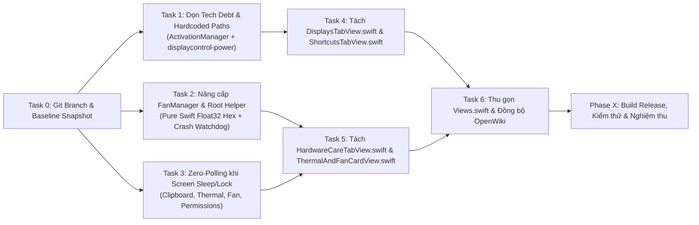

# Kế hoạch Triển khai: Tái cấu trúc Modular UI & Tối ưu Hệ thống HyperMac (Phương án A + B)

## 1. Overview (Tổng quan & Mục tiêu)
Nâng cấp toàn diện kiến trúc mã nguồn **HyperMac v1.9.4** theo sự kết hợp giữa **Phương án A (Tái cấu trúc Modular UI & Dọn sạch Tech Debt)** và **Phương án B (Hiện đại hoá Root Helper, Bảo vệ Phần cứng & Tối ưu Năng lượng Zero-Polling)** mà không làm thay đổi hành vi tính năng hay làm mất quyền TCC (`Accessibility` / `Screen Recording`) của người dùng.

- **Project Type**: Native macOS Application (Swift 5.9 + Objective-C, AppKit + SwiftUI, IOKit/SMC).
- **Primary Agent**: `project-planner` → `orchestrator` / `backend-specialist` (macOS System) + `frontend-specialist` (SwiftUI Modularization).
- **Active Skills**: `@[skills/plan-writing]`, `@[skills/clean-code]`, `@[skills/simplify-code]`, `@[skills/verify-changes]`.

---

## 2. Success Criteria (Tiêu chí nghiệm thu đo lường được)

| # | Hạng mục | Chỉ số hiện tại (Baseline v1.9.4) | Mục tiêu sau triển khai (Target) | Cách kiểm chứng (Verification) |
| :- | :--- | :--- | :--- | :--- |
| 1 | **Độ lớn file `Views.swift`** | `3.630` dòng (1 file duy nhất chứa tất cả các tab/card) | `< 950` dòng (chỉ giữ khung `ContentView`, Header, Footer, Modals); tách thành **5 file View chuyên biệt** | `wc -l Sources/*View*.swift` |
| 2 | **Độ trễ & Phụ thuộc khi chỉnh Quạt (SMC)** | Gọi `/usr/bin/python3` trong bash mỗi lần đổi RPM (`~60–120ms`/lần) | Tính sẵn chuỗi IEEE-754 Float32 LE Hex bằng Swift thuần (`0ms`), bash helper nhận/kiểm chứng trực tiếp hoặc tự tính bằng `awk`/`printf` không cần `python3` | `grep -n "python3" Resources/displaycontrol-power` trả về `0` kết quả; test `FanManager` encode `3000 RPM` → `00803b45` |
| 3 | **An toàn Quạt khi App Crash (`kill -9`)** | Quạt giữ nguyên tốc độ Manual nếu app bị Force Quit | Tự động khôi phục quạt về `F0Md=00` (System Auto) ngay khi PID của HyperMac biến mất | Chạy watchdog nền siêu nhẹ gắn với PID của HyperMac khi bật Manual Fan |
| 4 | **Tiêu thụ năng lượng khi máy nghỉ (Idle / Screen Sleep)** | `ClipboardManager` (`0,35s`), `ThermalManager` (`5s`), `FanManager` (`3s`), `PermissionsManager` (`2s`) chạy liên tục cả khi tắt màn hình | Tự động **Pause 100%** các timer này khi màn hình tắt (`screensDidSleepNotification`) hoặc khoá phiên (`sessionDidResignActiveNotification`) và **Resume** khi thức dậy | Kiểm tra log `/tmp/displaycontrol.log` và Activity Monitor Energy Impact = `0.0` khi tắt màn hình |
| 5 | **Đường dẫn Hardcode cục bộ** | Còn 4 vị trí trỏ cứng `/Users/khacdai24/Desktop/HyperMac/...` | `0` đường dẫn cá nhân; dùng đường dẫn tương đối động từ `Bundle.main` / `CommandLine.arguments[0]` | `grep -rn "khacdai24" Sources/ Resources/` trả về rỗng |
| 6 | **Biên dịch & Chữ ký TCC** | `swift build -c release` PASS | `swift build -c release` PASS 100%, `0` lỗi, giữ nguyên Bundle ID `com.opensource.hypermac` | Chạy `swift build -c release` |

---

## 3. File Structure (Cấu trúc thư mục sau khi tái cấu trúc)

```text
HyperMac-main/
├── Package.swift
├── build.sh
├── hypermac-refactor-optimization.md   # <--- File kế hoạch & theo dõi tiến độ này
├── openwiki/                           # Bộ tài liệu kiến trúc OpenWiki (8 files)
├── Resources/
│   ├── displaycontrol-power            # [CẬP NHẬT] Loại bỏ python3, thêm fan-watchdog theo PID, bỏ path khacdai24
│   ├── install-helper.sh
│   └── smc
└── Sources/
    ├── AppMain.swift                   # [CẬP NHẬT] Điều phối Screen Sleep/Wake & Session Lock observers
    ├── ActivationManager.swift         # [CẬP NHẬT] Xoá hardcode /Users/khacdai24, dùng dynamic path
    ├── FanManager.swift                # [CẬP NHẬT] Encode Float32 LE Hex thuần Swift + kích hoạt PID watchdog
    ├── ClipboardManager.swift          # [CẬP NHẬT] Hỗ trợ pause/resume polling khi màn hình ngủ
    ├── ThermalManager.swift            # [CẬP NHẬT] Hỗ trợ pause/resume HID sensor polling khi màn hình ngủ
    ├── PermissionsManager.swift        # [CẬP NHẬT] Hỗ trợ pause/resume TCC polling khi màn hình ngủ
    ├── Views.swift                     # [TÁI CẤU TRÚC] Còn ~850 dòng: ContentView, ModernHeaderBar, TopTabBar, FooterView, Modals
    ├── DisplaysTabView.swift           # [MỚI] Tách từ Views.swift: DisplaysTabView, DisplayCardView, VirtualDisplayCardView, CaffeinateCardView, MenuBarHiderCardView, QuickActionsBar
    ├── ShortcutsTabView.swift          # [MỚI] Tách từ Views.swift: ShortcutsTabView (AltTab, WindowSnap, Clipboard, Finder Cut/Paste, Screenshot cards)
    ├── HardwareCareTabView.swift       # [MỚI] Tách từ Views.swift: HardwareCareTabView, BatteryCardView, FileTransferSpeedCard
    ├── ThermalAndFanCardView.swift     # [MỚI] Tách từ Views.swift: ThermalAndFanCardView (cùng FanControlCardView.swift sẵn có)
    └── CleanerTabView.swift            # [GIỮ NGUYÊN] Tab dọn rác đã tách sẵn (629 dòng)
```

---

## 4. Sơ đồ Phụ thuộc Công việc (Task Dependency Graph)



---

## 5. Task Breakdown Chi tiết (8 Tasks — Theo dõi & Đánh giá)

### 🟢 Giai đoạn 0: Chuẩn bị & An toàn Mã nguồn (Vibe-Code Safety Protocol)

- [ ] **Task 0: Khởi tạo nhánh Git riêng & Kiểm tra Baseline Build**
  - **Agent**: `devops-engineer` | **Skill**: `@[skills/verify-changes]`
  - **Priority**: P0 (Blocker) | **Dependencies**: None
  - **INPUT**: Nhánh hiện tại của `/Users/kimtrungduong/Downloads/HyperMac-main`.
  - **OUTPUT**: Nhánh mới `feat/modular-ui-and-system-opt`, xác nhận `git status` sạch và `swift build` thành công trước khi sửa.
  - **VERIFY**: `git branch --show-current` trả về `feat/modular-ui-and-system-opt` và `swift build` exit code `0`.
  - **Rollback**: `git checkout main`.

---

### 🔵 Giai đoạn 1: Phương án B — Hiện đại hoá Hệ thống, Phần cứng & Zero-Polling

- [ ] **Task 1: Loại bỏ đường dẫn Hardcode cá nhân & Chuẩn hoá Resource Lookup**
  - **Agent**: `backend-specialist` | **Skill**: `@[skills/clean-code]`
  - **Priority**: P0 | **Dependencies**: Task 0
  - **Why**: Trong [`ActivationManager.swift`](file:///Users/kimtrungduong/Downloads/HyperMac-main/Sources/ActivationManager.swift#L132-L133) và [`Resources/displaycontrol-power`](file:///Users/kimtrungduong/Downloads/HyperMac-main/Resources/displaycontrol-power#L11-L12) đang trỏ cứng tới `/Users/khacdai24/Desktop/HyperMac/...`, gây lỗi nếu chạy bản dev trên máy khác.
  - **INPUT**: `Sources/ActivationManager.swift` (dòng 126–141), `Resources/displaycontrol-power` (dòng 8–16), `Sources/ThermalManager.swift` (dòng 189–196), `Sources/FanManager.swift` (dòng 247–256).
  - **OUTPUT**:
    - Tạo hàm tìm binary `smc` thống nhất ưu tiên: `/usr/local/bin/displaycontrol-smc` → `Bundle.main.path(forResource: "smc", ofType: nil)` → thư mục `Resources/smc` tính động từ `CommandLine.arguments[0]` hoặc `FileManager.default.currentDirectoryPath`.
    - Trong `Resources/displaycontrol-power`, dùng `SCRIPT_DIR="$(cd "$(dirname "$0")" && pwd)"` thay cho `/Users/khacdai24/...`.
  - **VERIFY**: Chạy `grep -rn "khacdai24" Sources/ Resources/` trả về `0` kết quả; `swift build` PASS.
  - **Rollback**: `git checkout -- Sources/ActivationManager.swift Resources/displaycontrol-power`.

- [ ] **Task 2: Chuyển đổi IEEE-754 Float32 Hex sang Swift thuần & Thêm Watchdog bảo vệ Quạt khi Crash**
  - **Agent**: `backend-specialist` | **Skill**: `@[skills/clean-code]`
  - **Priority**: P1 | **Dependencies**: Task 1
  - **Why**:
    1. Mỗi lần chỉnh tốc độ quạt, `displaycontrol-power` đang phải gọi `/usr/bin/python3 -c "import struct..."` tốn 60–120ms và yêu cầu máy phải có Python 3.
    2. Nếu HyperMac bị `kill -9` (Force Quit) khi quạt đang ở chế độ `Manual`, SMC giữ nguyên tốc độ quạt cố định không tự về `Auto`.
  - **INPUT**: [`Sources/FanManager.swift`](file:///Users/kimtrungduong/Downloads/HyperMac-main/Sources/FanManager.swift) và [`Resources/displaycontrol-power`](file:///Users/kimtrungduong/Downloads/HyperMac-main/Resources/displaycontrol-power).
  - **OUTPUT**:
    - Bổ sung hàm `static func rpmToFloat32LEHex(_ rpm: Int) -> String` ngay trong `FanManager.swift`:
      ```swift
      static func rpmToFloat32LEHex(_ rpm: Int) -> String {
          let bits = Float(rpm).bitPattern.littleEndian
          return withUnsafeBytes(of: bits) { bytes in
              bytes.map { String(format: "%02x", $0) }.joined()
          }
      }
      ```
    - Cập nhật `Resources/displaycontrol-power`: hỗ trợ nhận trực tiếp mã hex 8 ký tự đã kiểm chứng hoặc tự tính IEEE-754 float32 bằng `awk` chuẩn POSIX (loại bỏ hoàn toàn `/usr/bin/python3`).
    - Thêm cơ chế **PID Watchdog** trong `displaycontrol-power`: khi `fan-set` được gọi kèm PID của HyperMac (`fan-set <id> <rpm> [pid]`), khởi chạy một tiến trình canh gác nền kiểm tra `kill -0 <pid>` mỗi 5 giây; nếu tiến trình HyperMac biến mất (do crash/force-quit), tự động ghi `F0Md=00` trả quạt về `System Auto` rồi thoát.
  - **VERIFY**:
    - Kiểm chứng `FanManager.rpmToFloat32LEHex(3000) == "00803b45"`.
    - `grep -n "python3" Resources/displaycontrol-power` trả về `0` dòng.
    - Kiểm tra cú pháp `bash -n Resources/displaycontrol-power` exit code `0`.
  - **Rollback**: `git checkout -- Sources/FanManager.swift Resources/displaycontrol-power`.

- [ ] **Task 3: Triển khai Cơ chế Zero-Polling khi Màn hình Tắt / Khoá máy (Adaptive Power Saving)**
  - **Agent**: `backend-specialist` | **Skill**: `@[skills/performance-profiling]`
  - **Priority**: P1 | **Dependencies**: Task 0
  - **Why**: Khi người dùng khoá máy hoặc màn hình tắt (`screensDidSleepNotification`), việc quét `NSPasteboard` mỗi `0,35s` (`ClipboardManager`), quét cảm biến nhiệt mỗi `5s` (`ThermalManager`), quét SMC fan mỗi `3s` (`FanManager`, trừ khi đang chạy Manual Fan cần giữ cầu chì nhiệt 90°C!) và quét TCC mỗi `2s` (`PermissionsManager`) là hoàn toàn dư thừa, gây tiêu hao pin ngầm.
  - **INPUT**: `Sources/AppMain.swift`, `Sources/ClipboardManager.swift`, `Sources/ThermalManager.swift`, `Sources/FanManager.swift`, `Sources/PermissionsManager.swift`.
  - **OUTPUT**:
    - Thêm `setSystemSleepState(_ isAsleep: Bool)` cho các Manager định kỳ:
      - `ClipboardManager`: Tạm dừng timer `0,35s` khi màn hình ngủ, khôi phục ngay khi màn hình bật.
      - `PermissionsManager`: Tạm dừng timer `2,0s` khi màn hình ngủ.
      - `ThermalManager` & `FanManager`: Nếu `FanManager.shared.mode == .system`, tạm dừng quét cảm biến nhiệt và RPM khi màn hình ngủ; nếu `mode != .system` (đang ép xung quạt thủ công), **giữ nguyên** quét nhiệt độ để bảo đảm cầu chì an toàn `90°C` luôn hoạt động!
    - Đăng ký `NSWorkspace.screensDidSleepNotification` và `NSWorkspace.screensDidWakeNotification` trong `AppMain.swift` để điều phối tập trung.
  - **VERIFY**: `swift build` thành công; kiểm tra logic đảm bảo khi `FanManager.shared.mode != .system` cầu chì nhiệt `90°C` không bị tắt khi màn hình tắt.
  - **Rollback**: `git checkout -- Sources/AppMain.swift Sources/ClipboardManager.swift Sources/ThermalManager.swift Sources/FanManager.swift Sources/PermissionsManager.swift`.

---

### 🟣 Giai đoạn 2: Phương án A — Tái cấu trúc Modular UI (`Views.swift` 3.630 dòng → 5 File chuyên biệt)

- [ ] **Task 4: Tách `DisplaysTabView.swift` và `ShortcutsTabView.swift`**
  - **Agent**: `frontend-specialist` | **Skill**: `@[skills/simplify-code]`, `@[skills/clean-code]`
  - **Priority**: P2 | **Dependencies**: Task 1
  - **Why**: Tách 2 tab lớn nhất về hiển thị và phím tắt/cửa sổ ra khỏi `Views.swift` để cô lập phạm vi biên dịch.
  - **INPUT**: [`Sources/Views.swift`](file:///Users/kimtrungduong/Downloads/HyperMac-main/Sources/Views.swift) (dòng 569–1838).
  - **OUTPUT**:
    - Tạo `Sources/DisplaysTabView.swift` (~610 dòng): Chứa `DisplaysTabView`, `DisplayCardView`, `VirtualDisplayCardView`, `CaffeinateCardView`, `MenuBarHiderCardView`, `QuickActionsBar`, `EmptyStateView`.
    - Tạo `Sources/ShortcutsTabView.swift` (~665 dòng): Chứa `ShortcutsTabView` (cấu hình AltTab, Window Snapping, Clipboard History, Finder Cut & Paste, LightShot Screenshot).
  - **VERIFY**: `swift build` biên dịch thành công không phát sinh lỗi thiếu symbol hay `private` access control.
  - **Rollback**: `git checkout -- Sources/Views.swift && rm -f Sources/DisplaysTabView.swift Sources/ShortcutsTabView.swift`.

- [ ] **Task 5: Tách `HardwareCareTabView.swift` và `ThermalAndFanCardView.swift`**
  - **Agent**: `frontend-specialist` | **Skill**: `@[skills/simplify-code]`, `@[skills/clean-code]`
  - **Priority**: P2 | **Dependencies**: Task 2, Task 3, Task 4
  - **Why**: Tách toàn bộ giao diện Quản lý Pin, Sạc SMC, Sleep Guard, Auto-Calibration, CPU Freezer, Tốc độ Ổ cứng/NAS và Nhiệt độ/Quạt thành 2 module rõ ràng.
  - **INPUT**: [`Sources/Views.swift`](file:///Users/kimtrungduong/Downloads/HyperMac-main/Sources/Views.swift) (dòng 346–568 và 1839–2870).
  - **OUTPUT**:
    - Tạo `Sources/HardwareCareTabView.swift` (~940 dòng): Chứa `HardwareCareTabView`, `BatteryCardView`, `FileTransferSpeedCard`.
    - Tạo `Sources/ThermalAndFanCardView.swift` (~315 dòng): Chứa `ThermalAndFanCardView`.
  - **VERIFY**: `swift build` biên dịch thành công; kiểm tra dung lượng `Sources/Views.swift` giảm từ `3.630` dòng xuống còn `~890` dòng (chỉ còn `ContentView`, `ModernHeaderBar`, `TopTabBar`, `FooterView`, `UpdateModalView`, `DonateModalView`, `ActivationModalView`).
  - **Rollback**: `git checkout -- Sources/Views.swift && rm -f Sources/HardwareCareTabView.swift Sources/ThermalAndFanCardView.swift`.

- [ ] **Task 6: Đồng bộ tài liệu `openwiki/` và `AGENTS.md` với cấu trúc mới**
  - **Agent**: `explorer-agent` | **Skill**: `@[skills/openwiki]`
  - **Priority**: P3 | **Dependencies**: Task 4, Task 5
  - **INPUT**: `openwiki/ui.md`, `openwiki/patterns.md`, `openwiki/ipc.md`.
  - **OUTPUT**: Cập nhật sơ đồ các file UI mới (`DisplaysTabView.swift`, `ShortcutsTabView.swift`, `HardwareCareTabView.swift`, `ThermalAndFanCardView.swift`), cơ chế Float32 Hex thuần Swift + PID Watchdog và Adaptive Screen-Sleep Polling vào `openwiki/`.
  - **VERIFY**: Tất cả liên kết file trong `openwiki/` trỏ đúng tới các file mới tạo.

---

### 🏁 Phase X: Kiểm thử Tổng thể & Nghiệm thu (Final Verification)

- [ ] **Task 7 (Phase X): Build Release, Kiểm chứng Kỹ thuật & Đóng dấu Hoàn thành**
  - **Agent**: `test-engineer` | **Skill**: `@[skills/verify-changes]`, `@[skills/lint-and-validate]`
  - **Priority**: P0 (Final Gate) | **Dependencies**: Task 1–6
  - **Các bước kiểm tra bắt buộc**:
    1. **Kiểm tra Biên dịch Release**: `swift build -c release` (0 errors).
    2. **Kiểm tra Cú pháp Shell Scripts**: `bash -n Resources/displaycontrol-power && bash -n Resources/install-helper.sh && bash -n build.sh`.
    3. **Kiểm tra Dọn sạch Tech Debt**:
       - `grep -rn "khacdai24" Sources/ Resources/` → Trả về rỗng.
       - `grep -n "python3" Resources/displaycontrol-power` → Trả về rỗng.
       - `wc -l Sources/Views.swift` → `< 950` dòng.
    4. **Kiểm tra Bảo mật (`security_scan.py`)**: Chạy `python3 /Users/kimtrungduong/Downloads/.agents/skills/vulnerability-scanner/scripts/security_scan.py /Users/kimtrungduong/Downloads/HyperMac-main`.
    5. **Review `git diff`**: Đảm bảo không làm thay đổi bất kỳ key `UserDefaults` hay Bundle ID `com.opensource.hypermac` nào.

