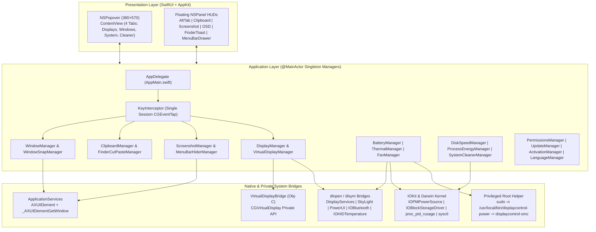

# Architecture Overview

HyperMac is architected as a two-target Swift Package Manager executable (`HyperMac` in Swift 5.9 and `VirtualDisplayBridge` in Objective-C) that coordinates 22 `@MainActor` singleton managers around a single session-level `CGEventTap`, dynamic private Apple framework bridges, and an optional passwordless root CLI helper for Apple Silicon SMC hardware control.

---

## 1. High-Level System Diagram

---

## 2. SwiftPM Target Structure ([`Package.swift`](file:///Users/kimtrungduong/Downloads/HyperMac-main/Package.swift))

HyperMac compiles without an `.xcodeproj` workspace using Swift Package Manager (`swift-tools-version: 5.9`, platform `.macOS(.v14)`):

1. **`VirtualDisplayBridge` (Objective-C Library Target)**
   - Path: [`Sources/VirtualDisplayBridge/`](file:///Users/kimtrungduong/Downloads/HyperMac-main/Sources/VirtualDisplayBridge/VirtualDisplayBridge.m)
   - Public Headers: [`Sources/VirtualDisplayBridge/include/VirtualDisplayBridge.h`](file:///Users/kimtrungduong/Downloads/HyperMac-main/Sources/VirtualDisplayBridge/include/VirtualDisplayBridge.h)
   - Purpose: Declares forward interfaces for undocumented CoreGraphics classes (`CGVirtualDisplayDescriptor`, `CGVirtualDisplayMode`, `CGVirtualDisplaySettings`, `CGVirtualDisplay`) and exposes `VDCreate`, `VDDestroy`, `VDGetDisplayID`, and `VDIsSupported` to Swift.
   - Compiler Flags: `-fobjc-arc`, `-Wno-deprecated-declarations`.

2. **`HyperMac` (Executable Target)**
   - Path: [`Sources/`](file:///Users/kimtrungduong/Downloads/HyperMac-main/Sources) (excluding `VirtualDisplayBridge`)
   - Dependencies: `VirtualDisplayBridge`
   - Linked System Frameworks: `IOKit`, `CoreGraphics`, `AppKit`, `SwiftUI`, `ApplicationServices`.

---

## 3. Private Framework & Undocumented Symbol Architecture

Because macOS restricts hardware brightness, display connection states, Apple Silicon die temperatures, window Z-Order IDs, and battery charge ceilings from public App Store APIs, HyperMac dynamically resolves private frameworks at runtime via `dlopen` and `dlsym`:

| Subsystem | Framework / Binary | Loaded Symbols | Purpose |
| :--- | :--- | :--- | :--- |
| **Built-in Display Brightness** | `/System/Library/PrivateFrameworks/DisplayServices.framework/DisplayServices` | `DisplayServicesGetBrightness`, `DisplayServicesSetBrightness` | Reads and writes native backlight nits on built-in Liquid Retina / XDR displays ([`IOKitBridge.swift`](file:///Users/kimtrungduong/Downloads/HyperMac-main/Sources/IOKitBridge.swift)). |
| **External Monitor Soft-Disconnect** | `/System/Library/PrivateFrameworks/SkyLight.framework/SkyLight` | `SLSMainConnectionID`, `SLSConfigureDisplayEnabled`, `SLSGetDisplayList` | Disconnects external displays in software without unplugging the cable and enumerates offline/disabled display IDs ([`DisplayManager.swift`](file:///Users/kimtrungduong/Downloads/HyperMac-main/Sources/DisplayManager.swift)). |
| **Virtual Display Creation** | `CoreGraphics.framework` (Obj-C runtime) | `CGVirtualDisplay`, `CGVirtualDisplayDescriptor`, `CGVirtualDisplayMode`, `CGVirtualDisplaySettings` | Instantiates virtual HiDPI displays (`vendorID=0x1234`, `productID=0x5678`) with 60Hz refresh and HiDPI scaling ([`VirtualDisplayBridge.m`](file:///Users/kimtrungduong/Downloads/HyperMac-main/Sources/VirtualDisplayBridge/VirtualDisplayBridge.m)). |
| **macOS 15+ Native Charge Limit** | `/System/Library/PrivateFrameworks/PowerUI.framework/PowerUI` | `OBJC_CLASS_$_PowerUISmartChargeClient`, `setMCLLimit:error:`, `getMCLLimitWithError:`, `disableMCL:` | Configures macOS Sequoia's native `powerd` charge ceiling for limits ≥ 80% without root privileges ([`BatteryManager.swift`](file:///Users/kimtrungduong/Downloads/HyperMac-main/Sources/BatteryManager.swift)). |
| **Bluetooth Power Control** | `/System/Library/Frameworks/IOBluetooth.framework/IOBluetooth` | `IOBluetoothPreferenceGetControllerPowerState`, `IOBluetoothPreferenceSetControllerPowerState` | Toggles Bluetooth controller power during Sleep Guard (`willSleepNotification` / `didWakeNotification`) ([`BluetoothManager.swift`](file:///Users/kimtrungduong/Downloads/HyperMac-main/Sources/BluetoothManager.swift)). |
| **Apple Silicon PMU Die Sensors** | `IOKit.framework` (HID Event System) | `IOHIDEventSystemClientCreateWithType`, `IOHIDEventSystemClientSetMatching`, `IOHIDServiceClientCopyEvent`, `IOHIDEventGetFloatValue` | Reads `kIOHIDEventTypeTemperature` (`15`, field `0xF0000`) across `PMU tdie*`, `PMU tdev*`, `gas gauge battery`, and `NAND` sensors ([`ThermalManager.swift`](file:///Users/kimtrungduong/Downloads/HyperMac-main/Sources/ThermalManager.swift)). |
| **AXUIElement → CGWindowID Bridge** | `ApplicationServices.framework` | `_AXUIElementGetWindow` | Maps an `AXUIElement` directly to its exact `CGWindowID` so AltTab can match same-title windows and capture per-window thumbnails ([`WindowManager.swift`](file:///Users/kimtrungduong/Downloads/HyperMac-main/Sources/WindowManager.swift)). |

---

## 4. Two-Tier Privilege Model (Root Helper Architecture)

HyperMac runs in user space by default. Features that write directly to Apple Silicon / Intel System Management Controller (SMC) keys or system-wide `pmset` registers use a lightweight, auditable root wrapper installed once via `NSAppleScript` (`with administrator privileges`):

- **Installer Script**: [`Resources/install-helper.sh`](file:///Users/kimtrungduong/Downloads/HyperMac-main/Resources/install-helper.sh)
  - Copies bundled `smc` binary → `/usr/local/bin/displaycontrol-smc` (`root:wheel`, `0755`).
  - Copies [`Resources/displaycontrol-power`](file:///Users/kimtrungduong/Downloads/HyperMac-main/Resources/displaycontrol-power) → `/usr/local/bin/displaycontrol-power` (`root:wheel`, `0755`).
  - Creates `/etc/sudoers.d/displaycontrol_power` (`0440`) granting `<username> ALL=(root) NOPASSWD: /usr/local/bin/displaycontrol-power`.
- **Helper Capabilities (`displaycontrol-power` v2)**:
  - `charge enable | disable | status | capabilities`: Probes and writes SMC keys (`bfF0`/`bfD0`/`bfE0` on M3/M4, `CHTE` on M2/M3/M4, `CH0B`/`CH0C` on M1, `BCLM` on Intel).
  - `limit <50-100>`: Sets `BCLM` hex value on Intel Macs.
  - `adapter on | off | status`: Controls `CH0I` / `CH0J` (Inhibit External Power / Discharge on AC for battery calibration).
  - `hibernatemode <0|3|25>`, `standby <0|1>`, `powernap <0|1>`, `tcpkeepalive <0|1>`, `womp <0|1>`: Wraps `/usr/bin/pmset -a`.
  - `fan auto | set <fanIndex> <rpm>`: Writes `F%dMd = 00/01` and converts target RPM to IEEE-754 float32 little-endian hex (`python3 struct.pack('<f', rpm).hex()`) into `F%dTg`.

---

## 5. Build, Packaging & TCC Code-Signing Lifecycle

macOS Transparency, Consent, and Control (TCC) ties Accessibility (`AXIsProcessTrusted`) and Screen Recording (`CGPreflightScreenCaptureAccess`) grants to the app's **Bundle ID + Code Signing Designated Requirement (CDHash or Certificate Authority)**.

- **[`build.sh`](file:///Users/kimtrungduong/Downloads/HyperMac-main/build.sh)**:
  1. Compiles universal or native release binary (`swift build -c release`).
  2. Assembles `HyperMac.app/Contents/{MacOS,Resources,Info.plist}` and copies `smc`, `displaycontrol-power`, `install-helper.sh`, `version.json`, and `AppIcon.icns`.
  3. Looks up a persistent certificate (`HyperMac Self-Signed` or `Apple Development`) in `login.keychain-db` (created via [`scripts/setup-signing-identity.sh`](file:///Users/kimtrungduong/Downloads/HyperMac-main/scripts/setup-signing-identity.sh)).
  4. Signs nested binaries (`Contents/Resources/smc`, `Contents/Resources/displaycontrol-power`) and the main bundle with explicit `identifier "com.opensource.hypermac"`.
  5. Preserves the existing `/Applications/HyperMac.app` bundle inode on local installs (`cp` binary in-place) so macOS `tccd` does not invalidate active permissions.
- **[`AccessibilityRecovery.swift`](file:///Users/kimtrungduong/Downloads/HyperMac-main/Sources/AccessibilityRecovery.swift)**:
  - On first launch of a new version (`lastAccessibilityAutoResetVersion`), if `AXIsProcessTrusted()` is `false`, runs `/usr/bin/tccutil reset Accessibility com.opensource.hypermac` automatically to purge stale ad-hoc CDHash entries before prompting the user.

