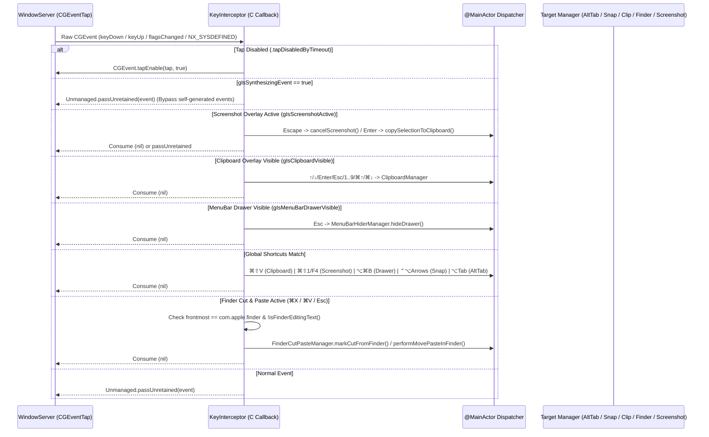
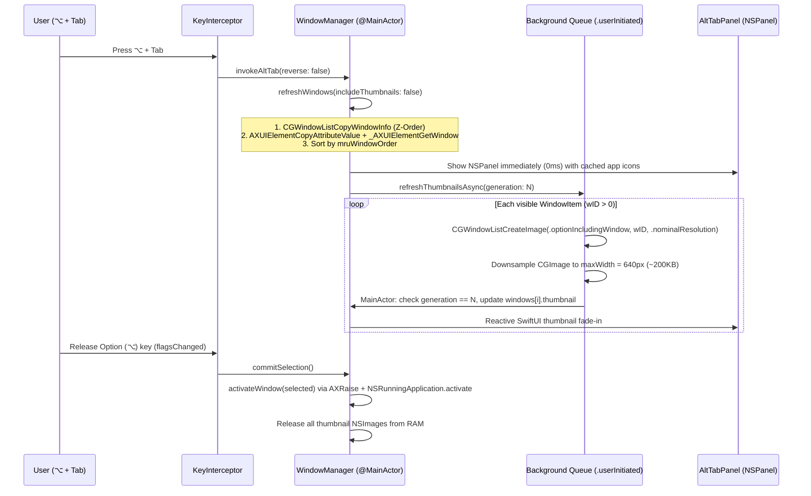
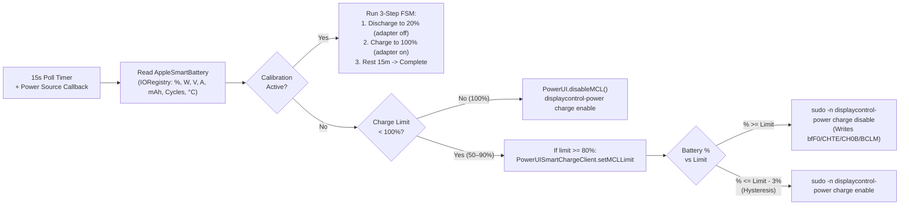

# Data Flow & Event Pipelines

This document traces the five core runtime pipelines in HyperMac: global keyboard/mouse interception, AltTab 0ms window switching, Finder Cut & Paste event synthesis, SMC battery/thermal control loops, and atomic OTA updates.

---

## 1. Global `CGEventTap` Key Routing Pipeline

[`KeyInterceptor.swift`](file:///Users/kimtrungduong/Downloads/HyperMac-main/Sources/KeyInterceptor.swift) installs a single session-level `CGEventTap` callback (`eventTapCallback`). Every event passes through a strict priority chain:

---

## 2. AltTab 0ms HUD & Asynchronous Thumbnail Pipeline

To eliminate lag on 4K/5K Retina displays while still showing live window previews, [`WindowManager.swift`](file:///Users/kimtrungduong/Downloads/HyperMac-main/Sources/WindowManager.swift) decouples window metadata discovery from bitmap capture:

---

## 3. Finder Cut & Paste (`⌘X` → `⌥⌘V`) Synthesis Flow

macOS Finder natively copies files with `⌘C` and moves them with `⌥⌘V`, but disables `⌘X` for file items. [`FinderCutPasteManager.swift`](file:///Users/kimtrungduong/Downloads/HyperMac-main/Sources/FinderCutPasteManager.swift) bridges this gap without breaking text editing when renaming a file:

1. **Context Validation (`KeyInterceptor`)**:
   - Checks `NSWorkspace.shared.frontmostApplication?.bundleIdentifier == "com.apple.finder"`.
   - Calls `FinderCutPasteManager.isFinderEditingText()`: inspects `kAXFocusedUIElementAttribute` role (`AXTextField`, `AXTextArea`, `AXSearchField`, `AXComboBox`). If the user is renaming a file or typing in Spotlight/Search, `⌘X` is passed through untouched!
2. **Cut Armed (`⌘X`)**:
   - Consumes the user's `⌘X`.
   - Sets `gIsSynthesizingEvent = true` and posts a synthetic `⌘C` (`keyCode 8`, `.maskCommand`) to `.cghidEventTap`.
   - After `120ms`, reads `NSPasteboard.general.readObjects(forClasses: [NSURL.self])`.
   - If valid file URLs exist, sets `isCutPending = true`, records `expectedChangeCount`, and displays `FinderCutToastView` (`"✂️ Cut N file — ⌘V to Move • Esc to Cancel"`).
   - Monitors pasteboard every `0.5s`; if the user copies something else (`changeCount != expectedChangeCount`), automatically disarms Cut mode.
3. **Move Execution (`⌘V`)**:
   - When `⌘V` is pressed in Finder while `isCutPending == true`, consumes `⌘V`.
   - Sets `gIsSynthesizingEvent = true` and posts a synthetic `⌥⌘V` (`keyCode 9`, `[.maskCommand, .maskAlternate]`) so Finder performs a native atomic file move.
   - Disarms `isCutPending` and shows `"✅ Moved N file"` toast.

---

## 4. Battery Charge Limiter & Sleep Guard Control Loop

[`BatteryManager.swift`](file:///Users/kimtrungduong/Downloads/HyperMac-main/Sources/BatteryManager.swift) coordinates `IOPSCopyPowerSourcesInfo`, `PowerUI.framework`, and the root SMC helper on a 15-second timer:

---

## 5. OTA Auto-Update Atomic Swap Flow

[`UpdateManager.swift`](file:///Users/kimtrungduong/Downloads/HyperMac-main/Sources/UpdateManager.swift) performs safe self-updating without breaking TCC permissions or leaving partial bundles:

1. **Check**: Fetches `https://raw.githubusercontent.com/trithucnen-max/HyperMac/main/version.json` every 4 hours (`URLSession` ephemeral config bypassing cache) and compares semantic version arrays against `UpdateManager.currentAppVersion` (`2.0`).
2. **Download**: Streams `HyperMac.zip` via `URLSessionDownloadDelegate`, publishing byte progress to the UI.
3. **Verify & Stage**:
   - Computes SHA-256 via `/usr/bin/shasum -a 256` against `version.json`'s `sha256` field (if present).
   - Extracts ZIP via `/usr/bin/ditto -x -k` into `/tmp/HyperMac_Update_<UUID>/`.
   - Verifies `/usr/bin/codesign --verify --deep --strict` on the staged `.app`.
4. **Atomic Swap Script**:
   - Generates a detached `/bin/bash` script `/tmp/hypermac_updater.sh` launched after the current PID exits:
     - Moves old `/Applications/HyperMac.app` → `/Applications/HyperMac.app.backup`.
     - Copies staged `.app` → `/Applications/HyperMac.app` via `ditto`.
     - Strips quarantine xattrs (`xattr -cr`).
     - Re-signs with `HyperMac Self-Signed` identity if available in Keychain so TCC Accessibility permissions remain valid!
     - Rolls back `.backup` if launch fails; otherwise deletes backup and opens the new app.

