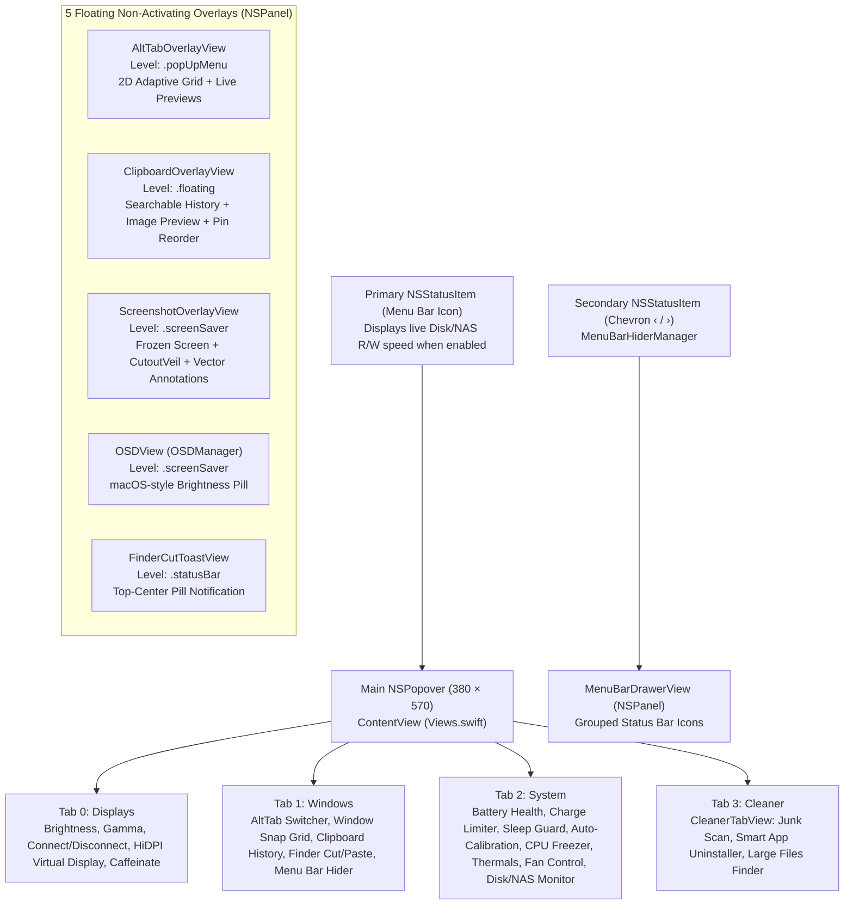

# UI Architecture & Design System

HyperMac uses a hybrid AppKit + SwiftUI presentation architecture: AppKit manages window levels, status bar items, popovers, and non-activating panels (`NSPanel`), while SwiftUI renders reactive views inside `NSHostingView` / `NSHostingController`.

---

## 1. UI Surfaces Overview

---

## 2. Main Popover & Modular Tab Views

1. **[`Views.swift`](file:///Users/kimtrungduong/Downloads/HyperMac-main/Sources/Views.swift) (438 lines — Root Container, Header, TabBar & Footer)**
   - Hosts `MainView` (the 4-tab container `selectedMainTab: 0..3`), `ModernHeaderBar`, `TopTabBar`, and `FooterView`.
2. **[`ModalsView.swift`](file:///Users/kimtrungduong/Downloads/HyperMac-main/Sources/ModalsView.swift) (672 lines — Overlay Modals)**
   - Hosts `UpdateModalView`, `DonateModalView`, and `ActivationModalView`.
3. **[`DisplaysTabView.swift`](file:///Users/kimtrungduong/Downloads/HyperMac-main/Sources/DisplaysTabView.swift) (607 lines — Tab 0: Displays)**
   - Per-display cards (`DisplayCardView`) with interactive brightness sliders (`0%–100%`), `25%/50%/75%/100%` presets, soft-disconnect toggles, `VirtualDisplayCardView` (HiDPI dummy display + Primary Screen Blackout), `CaffeinateCardView`, `MenuBarHiderCardView`, and `QuickActionsBar`.
3. **[`HardwareCareTabView.swift`](file:///Users/kimtrungduong/Downloads/HyperMac-main/Sources/HardwareCareTabView.swift) (~938 lines — Tab 1: Hardware & Battery)**
   - Hosts `HardwareCareTabView`, `FileTransferSpeedCard` (physical drives + NAS LAN throughput), and `BatteryCardView` (4 sub-tabs: SMC Power Limit, Sleep Guard, CPU Process Freeze, and 3-step Auto-Calibration).
4. **[`ThermalAndFanCardView.swift`](file:///Users/kimtrungduong/Downloads/HyperMac-main/Sources/ThermalAndFanCardView.swift) (~316 lines) & [`FanControlCardView.swift`](file:///Users/kimtrungduong/Downloads/HyperMac-main/Sources/FanControlCardView.swift) (183 lines)**
   - Renders Apple Silicon 6-sensor HID PMU thermal matrix, expandable 30+ sensor accordion, and SMC Fan RPM controller (`System` / `Medium` / `High` / Custom slider) with a 90°C safety trip and crash watchdog.
5. **[`ShortcutsTabView.swift`](file:///Users/kimtrungduong/Downloads/HyperMac-main/Sources/ShortcutsTabView.swift) (~664 lines — Tab 2: Shortcuts & Windows)**
   - Interactive configuration cards for Launch at Login, Caffeinate, Menu Bar Drawer, Finder Cut & Paste (`⌘X → ⌘V`), AltTab Window Switcher (`WindowManager`), Window Snapping (`WindowSnapManager`), Clipboard History (`ClipboardManager`), LightShot Screenshot (`ScreenshotManager`), and Mouse Chording.

2. **[`CleanerTabView.swift`](file:///Users/kimtrungduong/Downloads/HyperMac-main/Sources/CleanerTabView.swift) (629 lines)**
   - Sub-tabbed interface (`Junk`, `Apps`, `Large`):
     - **System Junk**: Expandable category rows (`User Cache`, `System Logs`, `Xcode DerivedData`, `Trash`) with drill-down modal sheet (`CleanCategoryDetailSheet`) to inspect, sort, reveal in Finder, and selectively clean individual subfolders.
     - **Smart Uninstaller**: Searchable application list showing `.app` bundle size + associated `~/Library` leftover badge (`+X MB rác`), with a preview confirmation sheet listing every path before moving to Trash.
     - **Large Files Finder**: Threshold filter (`100MB`, `200MB`, `500MB`, `1GB`) with multi-select batch Trash removal.

3. **[`PermissionsCardView.swift`](file:///Users/kimtrungduong/Downloads/HyperMac-main/Sources/PermissionsCardView.swift) (288 lines)**
   - Collapsible onboarding banner rendered at the top of `ContentView` whenever `PermissionsManager` detects missing Accessibility or Screen Recording permissions, offering 1-click deep links to `System Settings` and `tccutil` reset recovery.

---

## 3. Floating Overlay Panels (`NSPanel`)

| Overlay View | File | Window Level & Style | Key UX Features |
| :--- | :--- | :--- | :--- |
| **AltTab HUD** | [`AltTabOverlayView.swift`](file:///Users/kimtrungduong/Downloads/HyperMac-main/Sources/AltTabOverlayView.swift) | `.popUpMenu`, `[.borderless, .nonactivatingPanel]`, `[.canJoinAllSpaces, .fullScreenAuxiliary]` | Dynamically computes `columns` (`2..6`), `cardWidth` (`150..240pt`), and `thumbHeight` (`88..148pt`) to fit up to 3 rows on the active screen. Supports mouse hover selection (`NSMouseMoved`), `M` to minimize, `W`/`Delete` to close window, `Q` to quit app. |
| **Clipboard Overlay** | [`ClipboardOverlayView.swift`](file:///Users/kimtrungduong/Downloads/HyperMac-main/Sources/ClipboardOverlayView.swift) | `.floating`, `KeyablePanel` (`canBecomeKey = true`) | Centered `580×480` glass panel with instant search bar, category filter (`All`, `Pinned`, `Text`, `Images`, `Links`), `1–9` quick-paste badges, `⌘↑/⌘↓` pin reordering, and side-by-side image/text preview pane. |
| **Screenshot Canvas** | [`ScreenshotOverlayView.swift`](file:///Users/kimtrungduong/Downloads/HyperMac-main/Sources/ScreenshotOverlayView.swift) | `.screenSaver`, full-screen across active `NSScreen` | Frozen screen backdrop + `CutoutVeil` (even-odd path fill dimming outside selection) + 8 resize handles + Spacebar pan + vector annotation toolbar (`.pen`, `.arrow`, `.rect`, `.marker`, 6 colors, Undo, Save, Copy) + auto-repositioning edge collision logic. |
| **Menu Bar Drawer** | [`MenuBarHiderManager.swift`](file:///Users/kimtrungduong/Downloads/HyperMac-main/Sources/MenuBarHiderManager.swift), [`MenuBarAppTable.swift`](file:///Users/kimtrungduong/Downloads/HyperMac-main/Sources/MenuBarAppTable.swift) | `.popUpMenu`, borderless `NSPanel` anchored below menu bar | Groups running status bar items into "On Screen" vs "Hidden by Notch" sections with real app icons, search filter (`≥ 5` items), and click-through proxy execution. |
| **Brightness OSD & Finder Toast** | [`OSDManager.swift`](file:///Users/kimtrungduong/Downloads/HyperMac-main/Sources/OSDManager.swift), [`FinderCutPasteManager.swift`](file:///Users/kimtrungduong/Downloads/HyperMac-main/Sources/FinderCutPasteManager.swift) | `.screenSaver` / `.statusBar`, `ignoresMouseEvents = true` | Translucent `.ultraThinMaterial` pill overlays with auto-dismiss timers (`1.5s` for OSD, `3.0s` for Cut armed, `2.0s` for Move completed). |

---

## 4. Design System Tokens ([`Theme.swift`](file:///Users/kimtrungduong/Downloads/HyperMac-main/Sources/Theme.swift))

All views share three centralized design token namespaces in `Theme.swift`:

- **Typography (`enum FS`)**:
  - `FS.hero` (20pt bold rounded), `FS.title` (14pt semibold), `FS.section` (12pt bold), `FS.body` (12pt medium), `FS.label` (11pt medium), `FS.caption` (11pt regular), `FS.micro` (10pt semibold), `FS.badge` (10pt bold monospaced).
- **Corner Radii (`enum Rad`)**:
  - `Rad.card` (`12pt`), `Rad.control` (`8pt`), `Rad.badge` (`6pt`), `Rad.pill` (`999pt`).
- **Semantic Colors & Surfaces (`enum Tone`)**:
  - Status accents: `Tone.accent` (`.blue`), `Tone.good` (`.green`), `Tone.warn` (`.orange`), `Tone.danger` (`.red`), `Tone.Active` (`.purple`).
  - Adaptive glass surfaces: `Tone.cardSurface` (`white 0.06` dark / `black 0.035` light), `Tone.cardBorder` (`white 0.10` / `black 0.08`), `Tone.ElevatedSurface`, `Tone.TrackBackground`.
  - Reusable view modifiers: `.cardStyle(padding: 12)` and `StatusBadge(text:color:icon:)`.

